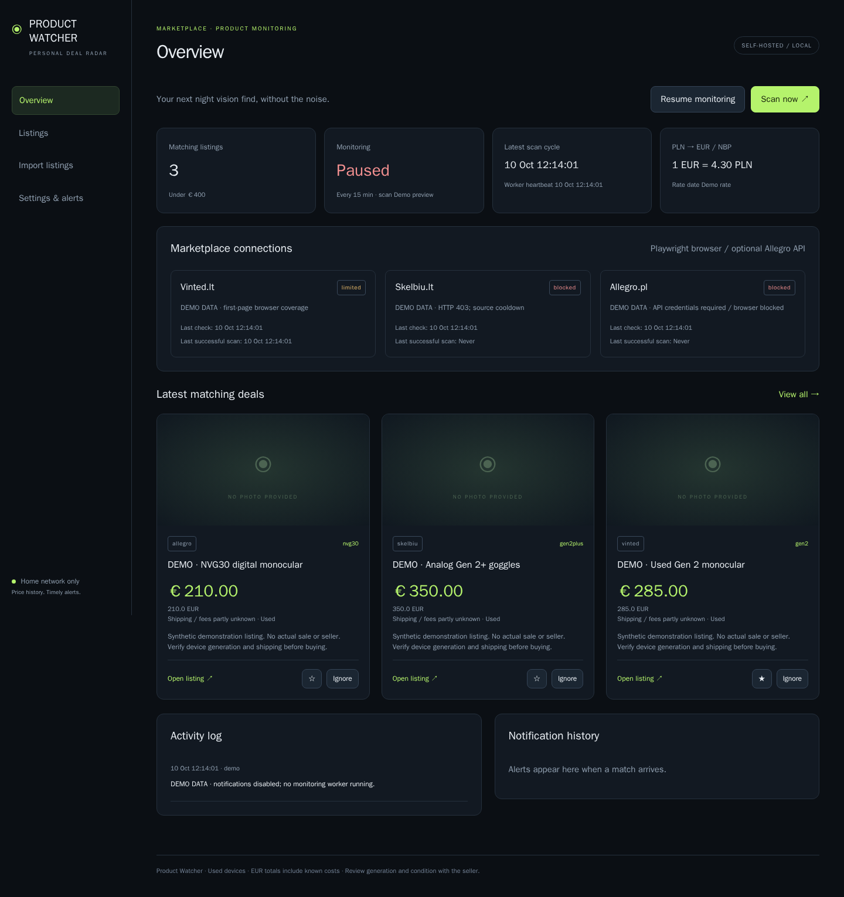
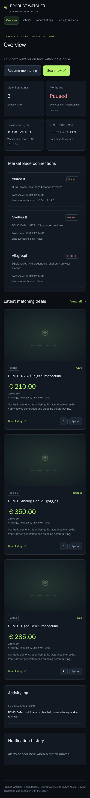
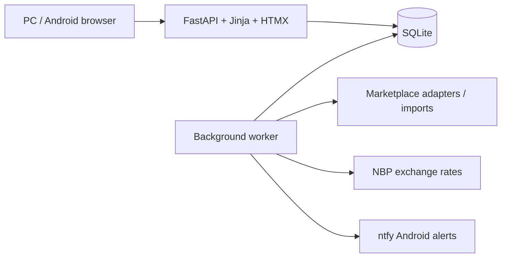

# Product Watcher

A self-hosted product monitoring dashboard that turns marketplace listings into searchable price history and Android alerts. Built for an Ubuntu home server with Python, FastAPI, HTMX, SQLite, Playwright, Docker Compose and ntfy.



## What it does

The current deployment is configured for used optical equipment. Category rules are specialized to that configuration; adapters and saved keywords do not make it a universal product classifier. The monitoring, price history, favorites, imports and notification infrastructure can be reused for other product categories after adapting the classification rules.

- Tracks used analog Gen 2 / Gen 2+ devices, unknown-generation analog candidates, and NVG30 / NVG50.
- Supports Lithuanian, Polish and English keywords. Excludes Gen 1, thermal, FPV and ordinary digital devices by default.
- Compares known total costs against a configurable EUR budget, including available shipping and fees; converts PLN using Poland’s NBP API.
- Keeps favorites, ignored items, listing history and price changes in SQLite.
- Sends ntfy alerts for new matches and significant price drops, with a persistent notification outbox and retries.
- Provides source toggles, editable filters, Scan now, Pause/Resume, status and error logs in a responsive dark interface.

Screenshots use synthetic data in an isolated demo instance. They illustrate the interface, not marketplace availability or actual deals.

## Integration reality

| Source | Implementation | Deployment verification |
| --- | --- | --- |
| Vinted.lt | Ordinary browser reads of public search/detail pages | Accessible during live verification; bounded first-page coverage |
| Skelbiu.lt | Ordinary browser reads | Initial pages accessible; subsequently HTTP 403 |
| Allegro.pl | Approved official API when credentials are supplied; browser fallback | Browser HTTP 403; official API credentials not configured |
| PLN conversion | Official NBP API | Live retrieval verified |
| Android alerts | ntfy publication | Publication and retrieval verified; phone receipt depends on subscription |

Access can change. Challenges and HTTP 401/403/429 stop collection and trigger a one-hour cooldown. No CAPTCHA solving, stealth modifications, proxy rotation or access-control bypass. Browser monitoring is not represented as marketplace-approved. Each cycle checks the first rendered page per keyword and at most twelve attempted detail pages per source. Manual JSON imports remain available. See [operations and limitations](docs/OPERATIONS.md).

## Run it

Requires Docker Engine with Compose, a Linux host and a trusted local network.

```sh
git clone https://github.com/mantaspeciukevicius/product-watcher.git
cd product-watcher
python3 scripts/configure.py
# Edit .env: LAN_IP and ALLOWED_CIDRS must match your network.
mkdir -p data && chmod 700 data
docker compose up -d --build --wait
```

Open `http://YOUR_LAN_IP:8765`. Sign in as `admin` using the generated `ADMIN_PASSWORD` in `.env`. The default bind is loopback until you deliberately configure a LAN address. Docker uses UID 1000 for data; adjust directory ownership if your host account uses another UID.

## Daily use

1. Open Settings, enable desired sources and review keywords/categories. Budget defaults to €400 and interval to 15 minutes.
2. Choose Scan now. The source panel shows progress, limited coverage, cooldowns or errors.
3. Review Listings. Favorite candidates, ignore individual items or mark false matches Irrelevant, and open a listing’s price history.
4. Install [ntfy for Android](https://ntfy.sh/), subscribe using the server/topic shown in Settings, allow notifications and background delivery, then use Test Notification.
5. Use Pause to stop scheduled collection. Queued notification delivery can continue. Scan now still works while paused.

Unknown shipping is labeled unknown. Text classification does not verify a seller’s device generation or condition. A price is eligible only when its known total is strictly below the budget.



## Architecture



Web and worker share a persistent bind-mounted database. Both restart automatically unless explicitly stopped. Authentication, LAN IP filtering, CSRF checks, read-only containers and dropped capabilities protect the deployment. Do not forward the port to the internet. HTTP Basic authentication should stay on a trusted LAN; configure TLS before use on an untrusted network.

## Tests

```sh
docker compose build
docker run --rm --network none --read-only --tmpfs /tmp:size=512m \
  --cap-drop ALL --security-opt no-new-privileges \
  -e DATA_DIR=/tmp/test-data -e XDG_CONFIG_HOME=/tmp/chromium-config \
  -e XDG_CACHE_HOME=/tmp/chromium-cache product-watcher:local \
  python -m pytest -q -p no:cacheprovider /srv/tests
```

73 automated tests cover multilingual classification, costs, deduplication/retries, persistence, access controls, imports, mocked API responses and browser parsing/challenge detection. No live marketplace credentials are needed. See [mock data](tests/mock_marketplaces.json) and [operational guide](docs/OPERATIONS.md) for imports, backups, troubleshooting and known limits.

More interface views: [screenshot gallery](docs/SCREENSHOTS.md).

## Portfolio notes

The engineering focus is a complete small deployment: durable background jobs, conservative classification, explicit source failures, responsive UI, isolated test fixtures and recoverable state. [LinkedIn project summary](docs/PORTFOLIO.md).

## Efficient scans and relevance feedback

Sort listings by discovery date (newest/oldest), price or category priority. Discovery means when the tracker first saved the item. Marking a false match Irrelevant teaches reversible, conservative title/camera-family rules; Ignore only suppresses the individual item. Review learned exclusions and undo examples in the Irrelevant tab.

Unchanged detail reads are cached for 24 hours, with new or changed search cards prioritized and current card prices/fees/condition preserved. Description-only edits may take up to 24 hours to appear. Ignored and irrelevant items skip detail requests. History is rechecked only when matching filters or exchange rates change; ingestion batches at most 50 items per transaction. Prepared feedback snapshots avoid repeatedly normalizing negative examples. The worker maintains a separate heartbeat during scans, honors its saved schedule after restarts, and reports scan duration. Browser request pacing and access-block cooldowns still apply.

Cached exclusions and new-condition details are refreshed after expiry when current search cards remain eligible. A cached known condition is reused when unchanged cards omit condition; explicit current card conditions always take precedence.
